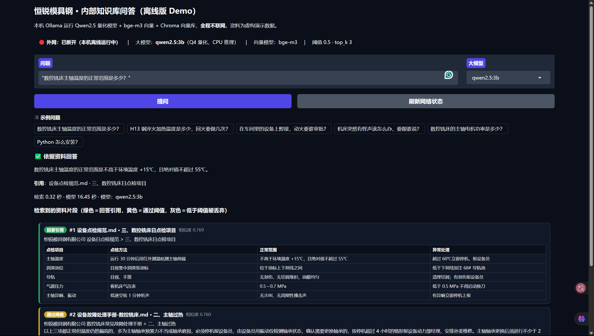
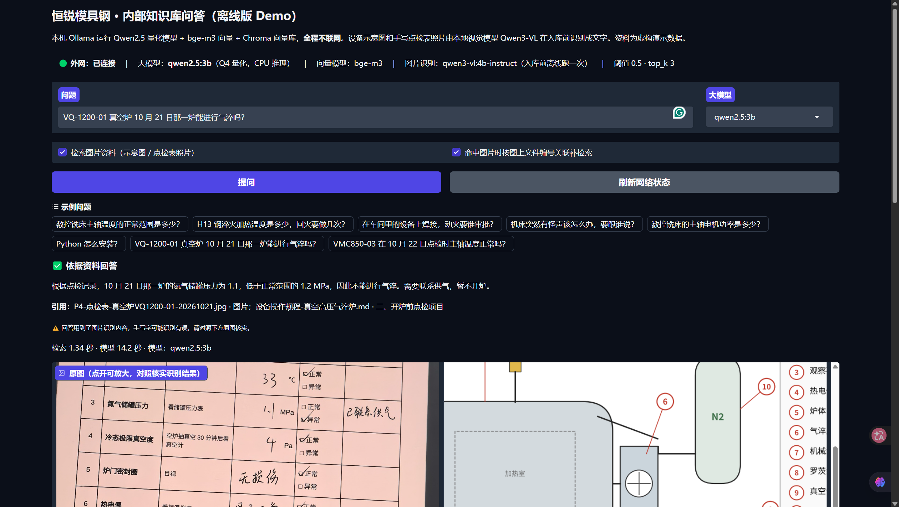

# 离线工厂知识库 Demo（本地大模型 + RAG，断网可用）

在一台**只有 CPU、没有独立显卡**的 Windows 笔记本上，用 Ollama 本地运行 Qwen2.5 量化模型，
把工艺卡、设备点检与故障手册、质量检验标准、规章制度做成可问答的内部知识库。**全部模型、向量库、界面都在本机，断网实测可用。**
设备示意图和手写点检表照片在入库前由本地视觉模型（qwen3-vl:4b-instruct）识别成文字，和文字资料一起检索；命中图片时，按图上印的文件编号到对应规范里补检索，回答"这次点检合不合格、该怎么处理"这类要结合图和文字的问题。
配套 82 题文字评估 + 22 题图片评估（失败题和关键题逐条复核），所有准确率数字都能追溯到 `results/` 下的 JSON。

> 演示资料全部虚构（"恒锐模具钢有限公司"），不涉及任何真实企业数据；点检表照片是自己手写填好后拍摄的，已去除 EXIF。





## 快速开始

前提：Windows / macOS / Linux 均可（本项目在 Windows 11 上开发和测试），Python 3.10+，已安装 [Ollama](https://ollama.com) 并在运行。

```bash
# 1. 拉取模型（只需一次，之后完全离线）
ollama pull qwen2.5:3b
ollama pull bge-m3
ollama pull qwen2.5:7b        # 可选，界面里可切换
ollama pull qwen3-vl:4b-instruct   # 可选：只有新增 / 修改图片、要重新识别时才需要

# 2. 安装依赖
python -m venv .venv
.venv\Scripts\activate        # macOS / Linux：source .venv/bin/activate
pip install -r requirements.txt

# 3. 建向量库（约 30 秒），再启动界面
#    图片的识别结果已随仓库提供（docs/images/_desc/），入库不需要视觉模型
python ingest.py
python app.py                 # Windows 也可以直接双击 start.bat
```

启动时会先预热模型（约 2～6 秒），然后自动打开浏览器 `http://127.0.0.1:7860`。
**地址用 `127.0.0.1`，不要用 `localhost`**（浏览器会把 localhost 解析成 IPv6，连不上）。

其他命令：

| 命令 | 作用 |
|---|---|
| `python describe_images.py` | 用视觉模型识别 `docs/images/` 下新增或改动的图片，结果存 `docs/images/_desc/*.json`（没变的图片跳过，`--force` 全部重跑；CPU 上点检表每张约 2.5 分钟、示意图约 1.5 分钟） |
| `python ingest.py` | 资料有改动时重建向量库（全量重建，12 份资料 + 7 张图片约 30 秒） |
| `python rag.py "问题"` | 命令行问一个问题，输出完整 JSON（含相似度、兜底原因、耗时） |
| `python rag.py --test` | 跑 `tests/questions.json` 全部 82 题，打印相似度和结果，写入 `results/threshold_test.json`（约 10 分钟） |
| `python eval.py` | 分类别评估 82 题，写入 `results/eval_v2_3b.json` + `.md`（约 9 分钟）；`--report` 只用已有结果和复核记录重新生成报告；`--threshold` / `--model` / `--ids` 用于阈值校准和 7b 对比 |
| `python eval.py --questions tests/questions_mm.json --name eval_mm_images_link` | 22 道图片题；加 `--no-images`（只检索文字）/ `--no-link`（不做关联补检索）做消融对比；`--name eval_v3` 为原 82 题回归 |
| `python tests/check_questions.py` | 对照资料原文校验测试集的答案标注（不调模型） |
| `python tests/compare_runs.py` / `compare_models.py` | 生成阈值对比 / 3b-7b 对比报告 |
| `ollama pull qwen2.5:3b` / `qwen2.5:7b` / `bge-m3` | 首次部署时拉取模型（之后完全离线） |

## 架构（文字流程链）

```
【入库】docs/*.md
   → 按"##"章节切 → 章节内按段落/表格分块（表格整块保留）→ 每块正文 ≤350 字，前面拼"文件标题 > 章节"
     · 超长段落按句子拆，相邻片段以整句重叠（≤100 字，不从半句开始）
     · 超长表格按行拆，每片都重复表头
   → bge-m3（Ollama 本地，1024 维）向量化
   → Chroma 本地持久化（chroma_db/，元数据存来源文件和章节）

【图片入库】docs/images/*.png|jpg（设备示意图 3 张、手写点检表照片 4 张）
   → describe_images.py：qwen3-vl:4b-instruct（本地，长边缩到 1280）按 JSON 输出
     · 点检表识别两遍：第一遍整表转写（数值、文字、文件编号），第二遍只问"判定"列勾在哪个方框
   → ingest.py：代码按固定模板把识别结果拼成一段文字（不用大模型改写）→ 一张图一个片段
     · 图上印的文件编号（如 HR-SB-003）→ 自动对应 docs 里的资料，存进元数据 related

【问答】用户问题
   → bge-m3 向量化 → Chroma 余弦检索 top_k=3（文字片段和图片片段一起排）
   → 关联补检索：通过阈值的片段里有图片 → 用"问题 + 图片片段正文"在它关联的资料里再检索，
     每张图补 1 个章节，最多补 2 个（问题里的"5 号部件""那台机器"在规范里搜不到，带上图片内容才找得到）
   → 第 1 层：相似度阈值 0.50 粗筛 —— 一个都没过 → 不调大模型，直接输出固定话术
   → 第 2 层：Qwen2.5（Q4 量化，CPU）一次调用，按 JSON Schema 输出 {answerable, answer, cited}
   → 第 3 层：代码判断 —— JSON 解析失败 / answerable=false / 回答为空 → 输出固定话术
                          否则输出回答 + 引用的"文件 · 章节"
   → Gradio 界面：先显示检索片段（绿=引用 / 黄=过阈值 / 紫=关联补充 / 灰=丢弃），再显示回答和耗时；
                  用到图片时显示缩略图和可放大的原图，提示"手写内容可能识别有误，请对照原图核实"
```

固定话术（只由代码输出，模型不参与措辞）：**资料中没有找到相关内容，建议咨询相关部门负责人**

## 关键参数（集中在 `rag.py` 顶部配置区）

| 参数 | 值 | 怎么定的 |
|---|---|---|
| `LLM_MODEL` | `qwen2.5:3b`（可切 `qwen2.5:7b`） | CPU 实测：3b 带资料首字约 6 秒、生成约 25 token/s；7b 分别约 15 秒、11 token/s。评估中模型耗时中位数 3b 7.2 秒、7b 19.6 秒。演示选 3b，界面下拉框可切换 |
| `EMBED_MODEL` | `bge-m3` | 和 Qwen 共用一个 Ollama 服务，不用装 torch，断网不用另配 HuggingFace |
| `SCORE_THRESHOLD` | 0.50 | 82 题实测：有答案题 top1 最低 0.527，完全无关题最高 0.456，0.50 落在两者之间；0.55 会在第 1 层误拦 3 道有答案题，0.45 召回无提升（详见下方"评估"） |
| `TOP_K` | 3 | 3 个片段约 700 token（第一轮实测 684 token），CPU 上读提示词约 6 秒，再多会明显变慢 |
| `CHUNK_SIZE` / `CHUNK_OVERLAP` | 350 / 100 字 | 按章节切，大多数章节正好一个片段；超长段落、超长表格才拆。重叠按整句取，原为 50 字，但资料里一句话常超过 50 字，整句重叠几乎总是 0，调到 100。`CHUNK_SIZE` 不含"文件标题 > 章节"前缀，片段实际最长约 390 字 |
| `TEMPERATURE` | 0.1 | 制度/工艺类问答要稳定、少发挥（注意：未固定随机种子，同配置重跑结果仍会有小幅波动，见"评估"） |
| `NUM_CTX` | 4096 | 足够放 3 个片段 + 提示词，再大占内存 |
| `KEEP_ALIVE` | 30m | 演示期间模型常驻内存，避免每问一次冷启动 |
| `VISION_MODEL` | `qwen3-vl:4b-instruct` | 只在入库前跑。三个候选（qwen3-vl 2b / 4b、qwen2.5vl:3b）里点检表手写识别最好，qwen2.5vl:3b 表单输出陷入重复、JSON 无效；Apache 2.0；推理时 `ollama ps` 4.03 GB。注意 `qwen3-vl:4b` 默认标签是思考版，`think=false` 关不掉，必须用 `-instruct` |
| `USE_IMAGES` / `LINK_EXPAND` / `LINK_MAX` | True / True / 2 | 检索图片片段、命中图片时做关联补检索、最多补 2 个片段（上下文最多 5 个片段）；界面上两个开关可现场对比 |

## 评估（v2，2026-10-20）

**资料与测试集**：12 份虚构资料 → 76 个片段。其中刻意放了结构相同的三张工艺卡（H13 / P20 / Cr12MoV）、三类设备的点检项、长段落故障手册（触发按句拆）和大表格检验标准（触发按行拆）。测试集 `tests/questions.json` 82 题，分 7 类，在跑任何检索之前写完并锁定（SHA256 见 `开发与评估记录.md`）；其中 12 题是写资料**之前**存档的"盲写题"。

**判分**：有答案题 = 没兜底且包含全部关键事实（数字 + 单位等）；无答案题 = 输出固定话术。失败题和自动判对的题都逐条复核，把"判分误差""边界题可接受""假通过（关键词对但夹了错话）"和真实错误分开，每条结论和理由都记录在 `tests/review_v2_*.json`，可以逐条核对。

**结果（qwen2.5:3b，阈值 0.50，全部 82 题，复核后；来源 `results/eval_v2_3b.json`）**

| 类别 | n | 检索命中（top3） | 回答正确 / 正确拒答 |
|---|---|---|---|
| direct（资料有直接答案） | 12 | 91.7% (11/12) | 91.7% (11/12) |
| paraphrase（口语化问法） | 10 | 90.0% (9/10) | 50.0% (5/10) |
| table_tier（先判断落在哪一档） | 11 | 100.0% (11/11) | 72.7% (8/11) |
| cross_chunk（要两个片段才能答全） | 8 | 100.0% (8/8)，两段都命中 75.0% (6/8) | 37.5% (3/8) |
| confusable（易混淆的相似资料） | 12 | 100.0% (12/12) | 100.0% (12/12) |
| **有答案合计** | **53** | **96.2% (51/53)** | **73.6% (39/53)**，误拒 7.5% (4/53) |
| negative_near（话题相近、资料没有） | 21 | — | 81.0% (17/21)，幻觉 4 题 |
| negative_far（完全无关） | 8 | — | 100.0% (8/8)，全部第 1 层拦下 |
| **无答案合计** | **29** | — | **86.2% (25/29)** |

- 兜底层级：第 1 层 8 题（不调模型）、第 2 层 20 题、第 3 层 0 题（82 次 JSON 全部解析成功）。
- 耗时：检索中位数 0.08 秒；模型中位数 7.17 秒、P90 9.53 秒（n=74）。
- 只看 test 集（去掉 15 道调参用的 dev 题）：有答案 72.1% (31/43)、无答案 83.3% (20/24)。

**阈值（`results/threshold_calibration_v2.md`）**：0.45 / 0.50（跑两次）/ 0.55 各全量跑一遍。0.55 在第 1 层误拦 3 道有答案题，有答案正确率降到 67.9%；0.45 召回没有提升，只多 2 次模型调用；**0.50 维持不变**。但同一配置跑两次也会有 2 题结论不同（模型输出不完全确定），所以 2～3 题以内的差别不能归因于阈值。话题相近的无答案题 top1 在 0.526～0.708，与有答案题几乎完全重叠，阈值拦不住，全靠第 2 层。

**3b / 7b（`results/model_comparison_v2.md`）**：在按"难"挑的 39 题上（不代表全量），复核后 7b 79.5% (31/39)，3b 两次 53.8% / 59.0%；表格分档 7b 90.9%、3b 72.7%。7b 模型耗时中位数 19.56 秒、P90 27.46 秒（3b 7.72 / 9.60 秒）。7b 两次都错的 8 题中 5 题是检索没把需要的片段送进 top3——下一步的瓶颈在检索，不在模型大小。

## 评估（v3：图片入库，2026-10-26）

**图片识别准确率**（对照填表时记录的真值逐字段核对）：

| | 结果 |
|---|---|
| 4 张手写点检表的核心字段 | **60/67（89.6%）**：实测值 21/21、判定（正常/异常）21/21、表头 16/20、手写异常说明 1/4 |
| 3 张设备示意图的部件标号 | 34/34；图上的文件编号全部读对（关联补检索依赖它） |
| 同一张点检表：正常拍摄 vs 斜拍 + 强反光 | 14/16 vs **6/16**（斜拍那张只做对比，不入库） |

- **点检表为什么识别两遍**：让模型一次转写整张表时，4 张表的"判定"几乎全输出"正常"，6 个"异常"勾只认出 0～1 个（换了三版提示词都一样）；把任务拆窄、只问"判定列每行勾在哪个方框"，4 张表 21/21、6 个"异常"全对，两次运行都一样。所以第一遍取数值和文字，判定以第二遍为准，每张多约 47 秒。
- 错误集中在**手写汉字**（人名、"班组长"、手写编号），数字全对；被涂改的备注如实输出"[涂改，无法辨认]"，没有编内容。
- 识别结果先存成 JSON，入库时由代码按模板拼文字（不让大模型改写或总结——总结里出现过"已上报班长"这类编造）。

**评估题**（`tests/questions_mm.json`，22 题，在跑视觉模型之前写完并锁定，只依据填表真值和资料原文，SHA256 见 `开发与评估记录.md`）：纯图片题 7（答案只在图里）、图文联合题 9（图里一半 + 规范里一半，如"点检表上 62℃ + 规范超过 60℃ 立即停机"）、无答案题 6（话题贴着图片，但图和资料都没有）。

**三组消融（qwen2.5:3b，各跑 2 次，复核后；来源 `results/eval_mm_*_3b*.json`）**

| 组 | 纯图片 n=7 | 联合题 n=9 | 联合题两份来源都进上下文 | 无答案 n=6 | 模型耗时中位数 / P90 |
|---|---|---|---|---|---|
| 只检索文字 | 0 / 0 | 0 / 0 | 0/9 | 5 / 5 | 7.3 / 12.0 秒 |
| 加图片 | 5 / 6 | 2 / 2 | 3/9 | 5 / 5 | 7.8 / 10.7 秒 |
| 加图片 + 关联补检索 | 4 / 5 | 3 / 3 | **7/9** | 4 / 4 | 12.3 / 15.6 秒 |
| 加图片 + 关联补检索（**qwen2.5:7b**） | **7 / 7** | **5 / 5** | 7/9 | **6 / 6** | 28.8 / 37.8 秒 |

- **关联补检索解决的是检索问题**：联合题"图和规范两份来源都进上下文"从 3/9 升到 7/9。例：真空炉题不关联时规程"开炉前点检项目"根本不在 top3，模型兜底"资料中没有"；关联后补进来，回答"1.1 MPa 低于 1.2 MPa，不得气淬"。
- **剩下的瓶颈在推理**：3b 只从 2/9 到 3/9。7b 在同样的上下文上（两个模型送进去的片段逐题相同）到 5/9，纯图片题和无答案题全对；但有两题 7b 和 3b 错在同一处——**数值比较**：写出了"36 + 15 = 51"却结论"53 不高于 51，符合"、"2.5% 符合 3%～5%"。这类判断更适合交给代码（把实测值和规范范围解析成数字再比较），换更大的模型不一定能解决。
- **关键词判分会高估联合题**：只检索文字时两次运行共有 5 次自动判对，逐条复核后全是假通过（规范原文里刚好有关键词，回答本身是错的）；加关联后 3b 每次都有 2 题"关键词齐了但结论错"（同一段里前后矛盾、把上限算错），只看自动判分会把联合题算成 5/9 和 4/9，实际是 3/9。
- 代价：多进 2 个片段后，3b 有一道纯图片题被两份部件清单搞混、一道无答案题把白班的数值说成夜班；检索耗时 0.11 → 1.49 秒（多了 1～2 次长查询的向量化），模型耗时 7.8 → 12.3 秒。
- 偏乐观的地方：关联补检索迭代了 3 版，是在其中 4 道题（MB07 / MB08 / MA02 / MB01）上看过结果后改的，这 4 题的结果偏乐观；之后冻结，没有再按测试题调。22 题样本小，同配置重跑会有 1～2 题波动。

**原 82 题回归（加图片 + 关联，3b，2 次，复核后；来源 `results/eval_v3_3b*.json`）**：有答案 39/53 → **44/53**（两次相同），无答案 25/29（第二轮两次为 25 / 27），检索命中 51/53 → 52/53，模型耗时中位数 7.17 → 8.28 秒。**文字问答没有变差**，但 +5 题里真正能归因于图片的只有 1 题（磨床冷却液：关联把点检规范第四节补了进来）；图片片段只在 7/82 题进上下文，其余变化的题检索结果和第二轮相同，属于提示词多了一条规则后的生成波动（变对 4 题、变错 3 题，其中新增 1 题幻觉）。

## 断网是怎么保证的

| 可能联网的地方 | 处理 |
|---|---|
| 大模型、向量模型 | 都由本机 Ollama 提供，`ollama pull` 一次后离线可用 |
| Chroma 默认向量模型（会联网下载 ONNX） | 不用它：入库和检索都显式传 bge-m3 向量 |
| Chroma / Gradio 使用统计 | `anonymized_telemetry=False`、`GRADIO_ANALYTICS_ENABLED=False` |
| Gradio 字体 | Gradio 6 默认字体打包在本地；中文用系统自带微软雅黑 |
| 系统代理 | Ollama 客户端 `trust_env=False`，直连 127.0.0.1，不经过代理 |

断网实测（关 Wi-Fi → 重启 Ollama 和 app）：两轮实测都通过，见 `screenshots/` 和 `开发与评估记录.md` 第 10 节。

## 目录

```
offline-factory-kb/
├── docs/                 12 份虚构资料（工艺卡 ×3、设备点检 / 故障手册 / 真空炉规程、质量检验标准、安全 / 危化品 / 培训 / 考勤 / 差旅制度）
│   └── images/           设备示意图 3 张 + 手写点检表照片 4 张（已去 EXIF）；_desc/ 为视觉模型识别结果
├── describe_images.py    视觉模型识别图片（点检表两遍），结果存 JSON
├── ingest.py             解析 + 切分 + 向量化 + 入库（含图片片段和文件编号关联）
├── rag.py                配置区 + 检索 + 关联补检索 + 三层把关 + 调 Ollama（--test 跑测试集）
├── eval.py               分类别评估 + 报告（合并复核记录）
├── app.py                Gradio 界面（图片片段带缩略图和原图区）
├── start.bat             一键启动
├── tests/                测试集 questions.json / questions_mm.json、盲写题存档、复核记录 review_*.json、校验和对比脚本
├── chroma_db/            向量库（运行 ingest.py 生成，不随仓库上传）
├── results/              评估结果 JSON / 报告（eval_v2_* 第二轮、eval_mm_* 图片题、eval_v3_* 原 82 题回归；threshold_test_v1.json 为第一轮 14 题留档）
├── screenshots/          断网测试和图片问答截图
├── requirements.txt
├── LICENSE
└── 开发与评估记录.md     选型、实测速度、切分、评估方法与结果、阈值校准、3b/7b 对比、图片入库、踩坑
```

## 已知局限

- **表格分档推理不稳**：3b 把"事假两天"答成直属主管（应为部门经理）、"病假 5 天"答成部门经理（应为人力资源部）、"30 件抽几件"答成 3 件（应为 6 件）。7b 能答对后两题，但这次"事假两天"7b 两次也答错了（第一轮只有 4 份资料时 7b 答对过）。
- **两段式问题容易误拒**：cross_chunk 3b 只有 37.5%，需要的两个片段都在上下文时也会判"答不了"；7b 好很多。
- **话题相近的无答案问题会编答案**：3b 在 21 题里编了 4 题（如"工龄 15 年年假 15 天"），7b 在同类题上也编过 1 题。
- **检索是下一个瓶颈**：资料变多后，个别原本能检索到的片段被挤出 top3（如磨床冷却液从第 2 名掉到第 8 名）；超长表格拆开后，可能只检索到其中一片（只看到方案 B，答成方案 A 的温度）。
- 模型自报的"引用片段"不完全可靠，个别回答的内容来自没被标为引用的片段；还发现过 3b 在相关片段没进上下文时，用常识"答对"的情况。
- 评估的局限：测试题由开发者编写（写资料前存档的盲写题正确率 50% (6/12)，明显低于看着资料新写的题 83.9% (47/56)，说明自写题会高估准确率）；复核没有第二人交叉校验；模型输出不完全确定，重跑会有 2 题左右的波动。
- **图片相关**：手写汉字会认错（人名、"班组长"等），错误会被模型原样写进回答，所以界面要求对照原图核实；斜拍 + 反光时识别率从 14/16 降到 6/16；"图里的 5 号部件报警了怎么办"这类两跳问题（标号 → 部件名 → 规范里该部件的处理）关联补检索也找不到对应章节，需要先做查询改写；数值是否超限目前靠模型判断，3b、7b 都会比错。
- 图片题只有 22 道、示意图是代码画的（比真实照片简单），识别准确率和问答准确率都只能说明"在这批图上"的表现。
- 只支持 Markdown 资料和图片；扫描件 PDF 需要先 OCR（本 Demo 未实现，生产上可用离线 OCR 引擎处理后再入库）。
- 单机单用户演示，没有做权限、并发和资料版本管理。

## 许可证

代码以 [MIT](LICENSE) 许可证开源。模型不包含在本仓库中，需通过 Ollama 自行拉取，并遵守各自的许可证：qwen2.5:3b 为 Qwen Research License（研究用途，商用需另行授权），qwen2.5:7b 为 Apache 2.0，bge-m3 为 MIT，qwen3-vl:4b-instruct 为 Apache 2.0（以 HuggingFace 官方仓库为准；qwen2.5vl:3b 在 Ollama 包内标 Apache 2.0，官方实为 Qwen Research License，本项目未采用）。
